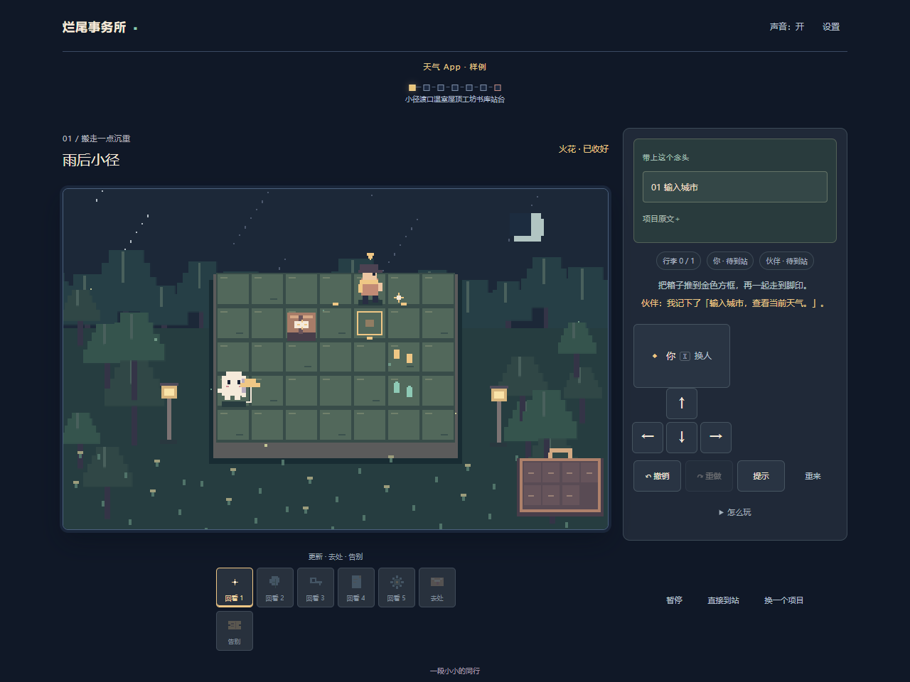
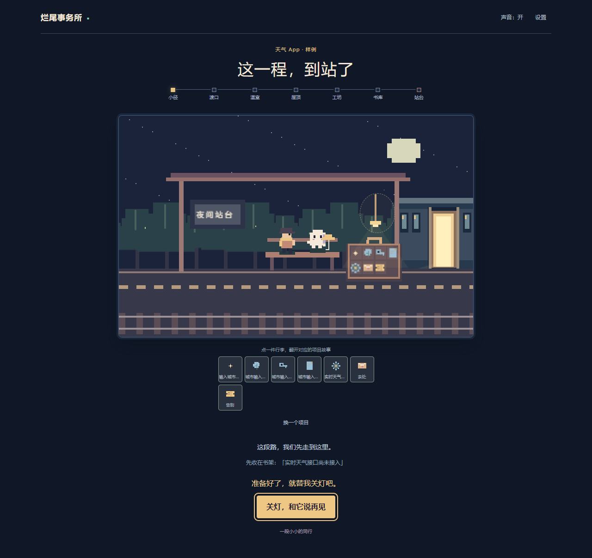

# 烂尾事务所 · 再走一小段

公开试玩地址：https://mtmt0111.github.io/unfinished-office-play/

截图使用内置天气 App 样例；回忆页里的个人补记是演示输入，不代表真实仓库提交或项目经历。本仓库保存公开试玩构建和展示截图。天气与小说样例、手动整理和七站游戏可以直接体验；GitHub 仓库读取与 DeepSeek 分析需要本地完整服务，不在这个公开试玩站提供。

更新时，从 `D:\CodexProjects\UnfinishedOffice` 执行 `npm run build`，再将 `dist` 内容复制到本仓库并推送到 `main`。截图由项目浏览器流程生成，放在 `screenshots/`；仓库不包含项目导入材料、测试日志、服务端程序或 API 密钥。
